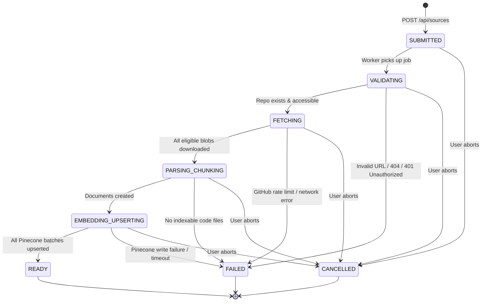
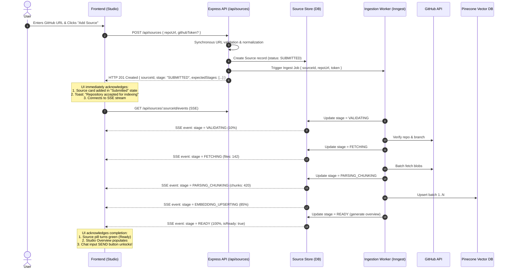

# High-Level Design: NotebookLM-Style Codebase Intelligence Platform

**Document:** `docs/HLD_NOTEBOOK_STYLE_CODE_CHATBOT.md`  
**Status:** Review & Decision Pending (Phase 1: Analysis & Design)  
**Target Architecture:** Google NotebookLM Paradigm for Code Repositories  

---

## 1. Current State Audit

### 1.1 Architecture & Flow Today

The existing repository consists of two primary applications:
1. **Backend (`company-ocr/`)**: Node.js/Express service orchestrating GitHub fetching, LangChain chunking, Inngest background job dispatch, Pinecone vector storage, and OpenAI RAG queries.
2. **Frontend (`frontend/`)**: React (Vite) single-page application using `@tanstack/react-query` and Tailwind CSS.

```
[User Submits Repo Link]
           │
           ▼
[Frontend: RepositoryIndexer.jsx]
           │  POST /api/index { repoUrl, githubToken? }
           ▼
[Backend: src/routes/index.route.js]
           │  1. parseRepo(repoUrl)
           │  2. inngest.send({ name: "repo/index", data })
           │  3. Returns HTTP 202 { message: "Indexing started", repoKey }
           ├──────────────────────────────────────────────┐
           ▼                                              ▼
[Frontend: RepositoryIndexer.jsx]               [Inngest Background Job]
  - Receives HTTP 202 in ~200ms                   src/inngest/functions/indexRepo.js
  - Sets indexAcknowledged = true                   Step 1: fetch-files (Octokit)
  - Shows "Repository Indexed!"                     Step 2: chunk-files (LangChain)
  - Unblocks Chatbot Phase                          Step 3: upsert-vectors-batch-N
           │                                              │
           ▼                                              ▼
[User asks query in CodebaseChatbot.jsx]        (Runs asynchronously for minutes;
  - POST /api/query                              updates NO database or status API)
  - Queries Pinecone namespace
  - Returns empty/partial context to GPT-4o-mini
```

#### Detailed Breakdown by File & Endpoint

1. **Submission Flow (`company-ocr/src/routes/index.route.js`)**:
   * **Endpoint**: `POST /api/index`
   * **Input**: `{ repoUrl: string, githubToken?: string }`
   * **Logic**: Calls `parseRepo(repoUrl)` in `src/services/github.js`. Falls back to `process.env.GITHUB_TOKEN`. Dispatches Inngest event:
     ```javascript
     await inngest.send({
       name: "repo/index",
       data: { repoUrl, githubToken: token },
     });
     ```
   * **Output**: HTTP 202 `{ message: "Indexing started", repoKey: parsed.repoKey }`.
   * **Data Model**: **None**. No job ID, task ID, or database record is created.

2. **Ingestion & Indexing Pipeline (`company-ocr/src/inngest/functions/indexRepo.js`)**:
   * **Trigger**: Inngest event `repo/index`.
   * **Step 1 (`fetch-files`)**: Uses `@octokit/rest` via `getRepoFiles(token, owner, repo)` in `src/services/github.js`. Recursively traverses git tree and downloads blobs in parallel batches (`BLOB_CONCURRENCY = 10`).
   * **Step 2 (`chunk-files`)**: Calls `chunkText(files, repoKey)` in `src/services/chunker.js`. Splits files using LangChain's `RecursiveCharacterTextSplitter` (chunkSize = 2000, chunkOverlap = 400).
   * **Step 3 (`upsert-vectors-batch-N`)**: Batches documents in slices of 500 (`STEP_BATCH_SIZE = 500`). Calls `upsertDocuments(batch, repoKey)` in `src/services/vectorStore.js`, which posts batches of 96 to Pinecone Documents API. Namespace used: `repoKey.replace("/", "-")`.
   * **Output**: Returns `{ repoKey, filesIndexed, chunksUpserted }` internally to Inngest engine only.

3. **Status Reporting (`company-ocr/src/index.js`)**:
   * **Endpoint**: `GET /api/status`
   * **Logic**: Returns static environment flags:
     ```json
     {
       "status": "online",
       "service": "GitWiki Semantic Knowledge Engine",
       "pineconeIndex": "ocr",
       "hasGithubToken": true,
       "hasPineconeKey": true,
       "hasOpenAIKey": true
     }
     ```
   * **Deficiency**: Does **not** report any information regarding active, pending, or completed repository indexing tasks.

4. **Chat & Query Flow (`company-ocr/src/routes/query.route.js` & `src/services/query.js`)**:
   * **Endpoint**: `POST /api/query`
   * **Input**: `{ repoUrl: string, query: string, topK?: number }`
   * **Logic**: Normalizes repository key with `prepareQuery()`. Directly invokes `similaritySearch()` against Pinecone namespace `repoKey.replace("/", "-")`. Passes context to `ChatOpenAI` (`gpt-4o-mini`).
   * **Deficiency**: Performs **zero validation** on whether the repository has actually been indexed or if ingestion is still running.

5. **Frontend State & Consumption (`frontend/src/`)**:
   * `RepositoryIndexer.jsx`: Invokes `POST /api/index`. Upon receiving HTTP 202, it instantly triggers `indexAcknowledged = true`. Displays a static 4-stage animation for 200ms, then renders an alert declaring *"Repository Indexed!"*.
   * `CodebaseChatbot.jsx`: Accepts user prompts. Gating allows messages to be sent regardless of whether the backend has indexed the repository.

---

### 1.2 Audit Gap Analysis Table

| Issue | Where (File / Function) | Impact | Proposed Fix |
| :--- | :--- | :--- | :--- |
| **Fake Index Completion** | `frontend/src/components/indexing/RepositoryIndexer.jsx` (`handleSubmit`) | Frontend treats HTTP 202 (~200ms) as total job completion. Users query an unindexed namespace and receive empty responses from GPT-4o-mini. | Replace instant completion with persistent `sourceId`, pollable/streamable state machine, and lock chat until state is verified `READY`. |
| **Simulated Step Progress** | `frontend/src/components/indexing/RepositoryIndexer.jsx` (Progress UI block) | Progress indicators (Parse, Fetch, Chunk, Upsert) are static CSS pulse animations tied to the pending HTTP request, not backend reality. | Emit real pipeline stage transitions and file/chunk counters from backend via SSE/status API. |
| **Missing Status API** | `company-ocr/src/index.js` (`GET /api/status`) | Endpoint only returns whether `.env` keys exist. There is no route to ask *"What is the indexing status of source X?"*. | Introduce `GET /api/sources/:sourceId/status` and `GET /api/sources/:sourceId/events`. |
| **No Job / Source Persistence** | `company-ocr/src/routes/index.route.js` | Inngest event is dispatched without writing a record to a database. Backend has no memory of what repos are being indexed. | Introduce an embedded persistent data store (`Source` and `Job` records) with UUIDs. |
| **Silent Background Failures** | `company-ocr/src/inngest/functions/indexRepo.js` | If GitHub 404s, rate-limits, or Pinecone rejects chunks, Inngest retries/fails silently; Express and UI never find out. | Catch step failures, record explicit error codes in the source store, and transition state to `FAILED`. |
| **Ungated Chat Queries** | `frontend/src/components/chat/CodebaseChatbot.jsx` & `company-ocr/src/routes/query.route.js` | Chat input and query endpoint allow queries against unindexed or partially indexed repositories. | Enforce backend guard in `query.route.js` returning HTTP 409 if source is not `READY`. Block frontend send button while typing remains enabled. |
| **Session Loss on Refresh** | `frontend/src/App.jsx` (`activeRepo` state) | Refreshing the browser resets in-memory states and leaves the user disconnected from ongoing background jobs. | Restore sources and job states from `GET /api/sources` on load. |

---

## 2. High-Level Design (HLD)

### 2.1 Backend Pipeline as an Explicit State Machine

To guarantee that the UI only reflects backend truth, repository ingestion is modeled as a deterministic state machine:



#### Detailed Stage Specifications

| Stage | Name | Entry Condition | Exit Condition | Progress Payload | Error Handling & Retry Policy |
| :--- | :--- | :--- | :--- | :--- | :--- |
| **0** | `SUBMITTED` | Client calls `POST /api/sources`. Source record created in DB. | Ingestion worker receives event. | `{ queuedAt, sourceId, repoUrl }` | Instant synchronous validation of URL format. Fails fast with HTTP 400 if syntax is invalid. |
| **1** | `VALIDATING` | Worker initializes GitHub API client. | Octokit confirms repo exists, branch resolved, commit SHA stored. | `{ owner, repo, defaultBranch, commitSha }` | Fast failure on HTTP 404/401/403. No retry. Marks job `FAILED` with descriptive error. |
| **2** | `FETCHING` | Validation succeeds; git tree retrieval starts. | Recursive tree parsed and all eligible blobs (<500KB) buffered. | `{ filesTotal, filesFetched, bytesFetched, currentBatch, totalBatches }` | 3 retries with exponential backoff on GitHub 5xx or transient connection reset. |
| **3** | `PARSING_CHUNKING` | Raw files array passed to LangChain splitter. | All files split into Document chunks with source metadata. | `{ filesProcessed, totalFiles, chunksProduced }` | Corrupted/empty files skipped with warning log; continues remaining files. Fails only if 0 chunks produced. |
| **4** | `EMBEDDING_UPSERTING`| Chunks array partitioned into Pinecone batches. | All vector batches confirmed by Pinecone Documents API. | `{ chunksTotal, chunksUpserted, currentBatch, totalBatches, namespace }` | Up to 5 retries with jitter on Pinecone 429 (rate-limit) or 503 (service unavailable). |
| **5** | `READY` | Pinecone upsert complete; summary generated. | Terminal state. Unlocks chat interactions. | `{ indexedAt, totalFiles, totalChunks, namespace, summary }` | None. |
| **6** | `FAILED` | Unrecoverable error encountered in stages 1–4. | Terminal state. | `{ failedStage, errorCode, errorMessage, failedAt }` | Client receives actionable failure reason; "Retry" button resets job to `SUBMITTED`. |
| **7** | `CANCELLED` | User triggers `DELETE /api/sources/:id` during ingestion. | Terminal state. Partial vectors purged from namespace. | `{ cancelledAt, stageAtCancel }` | Best-effort abort of active Inngest/worker execution. Purges Pinecone namespace. |

---

### 2.2 Status API Contract

#### Update Mechanism Evaluation: Server-Sent Events (SSE) with Fallback Polling

* **Why SSE over WebSocket?**
  * Repository ingestion telemetry is strictly **unidirectional** (server pushing stage updates to client).
  * WebSockets require bidirectional protocol negotiation, ping/pong heartbeats, and complex state management across load balancers.
  * SSE operates over standard HTTP/HTTPS, auto-reconnects on disconnection natively in browsers via `EventSource`, and passes through corporate proxies cleanly.
* **Why SSE over Pure Polling?**
  * Instant UI reflection when a batch finishes. Zero delay on stage transitions.
  * Eliminates redundant HTTP polling requests while still providing a lightweight HTTP polling snapshot endpoint (`GET /api/sources/:id/status`) as an automatic fallback.

#### API Endpoints
1. `GET /api/sources`: Returns all sources with their current stage and metrics.
2. `GET /api/sources/:sourceId/status`: Returns single JSON snapshot of source status.
3. `GET /api/sources/:sourceId/events`: SSE endpoint streaming continuous status changes.

#### Response Schema (TypeScript Definition)

```typescript
interface SourceStatusResponse {
  sourceId: string;
  repoUrl: string;
  repoKey: string;
  namespace: string;
  stage: "SUBMITTED" | "VALIDATING" | "FETCHING" | "PARSING_CHUNKING" | "EMBEDDING_UPSERTING" | "READY" | "FAILED" | "CANCELLED";
  isReady: boolean;
  progress: {
    percentage: number;          // 0 to 100
    currentStep: number;         // 1 to 5
    totalSteps: 5;
    stageDescription: string;
    filesCount?: number;
    filesProcessed?: number;
    chunksCount?: number;
    chunksUpserted?: number;
  };
  summary?: {
    overview: string;
    primaryLanguages: string[];
    suggestedQueries: string[];
  };
  error?: {
    code: string;
    message: string;
    stage: string;
  };
  updatedAt: string;             // ISO-8601 string
}
```

#### Sample JSON Responses by Stage

* **Stage 1: VALIDATING**
  ```json
  {
    "sourceId": "src_9a4f21e0",
    "repoUrl": "https://github.com/expressjs/express",
    "repoKey": "expressjs/express",
    "namespace": "expressjs-express",
    "stage": "VALIDATING",
    "isReady": false,
    "progress": {
      "percentage": 10,
      "currentStep": 1,
      "totalSteps": 5,
      "stageDescription": "Validating repository access and resolving default branch..."
    },
    "updatedAt": "2026-11-15T08:20:00.120Z"
  }
  ```

* **Stage 2: FETCHING**
  ```json
  {
    "sourceId": "src_9a4f21e0",
    "repoUrl": "https://github.com/expressjs/express",
    "repoKey": "expressjs/express",
    "namespace": "expressjs-express",
    "stage": "FETCHING",
    "isReady": false,
    "progress": {
      "percentage": 35,
      "currentStep": 2,
      "totalSteps": 5,
      "stageDescription": "Fetching repository files from GitHub tree...",
      "filesCount": 142,
      "filesProcessed": 58
    },
    "updatedAt": "2026-11-15T08:20:14.450Z"
  }
  ```

* **Stage 3: PARSING_CHUNKING**
  ```json
  {
    "sourceId": "src_9a4f21e0",
    "repoUrl": "https://github.com/expressjs/express",
    "repoKey": "expressjs/express",
    "namespace": "expressjs-express",
    "stage": "PARSING_CHUNKING",
    "isReady": false,
    "progress": {
      "percentage": 60,
      "currentStep": 3,
      "totalSteps": 5,
      "stageDescription": "Splitting code files into semantic chunks (2000 chars, 400 overlap)...",
      "filesCount": 142,
      "filesProcessed": 142,
      "chunksCount": 420
    },
    "updatedAt": "2026-11-15T08:20:25.800Z"
  }
  ```

* **Stage 4: EMBEDDING_UPSERTING**
  ```json
  {
    "sourceId": "src_9a4f21e0",
    "repoUrl": "https://github.com/expressjs/express",
    "repoKey": "expressjs/express",
    "namespace": "expressjs-express",
    "stage": "EMBEDDING_UPSERTING",
    "isReady": false,
    "progress": {
      "percentage": 85,
      "currentStep": 4,
      "totalSteps": 5,
      "stageDescription": "Upserting document vectors into Pinecone (batch 3 of 5)...",
      "chunksCount": 420,
      "chunksUpserted": 300
    },
    "updatedAt": "2026-11-15T08:20:42.110Z"
  }
  ```

* **Stage 5: READY**
  ```json
  {
    "sourceId": "src_9a4f21e0",
    "repoUrl": "https://github.com/expressjs/express",
    "repoKey": "expressjs/express",
    "namespace": "expressjs-express",
    "stage": "READY",
    "isReady": true,
    "progress": {
      "percentage": 100,
      "currentStep": 5,
      "totalSteps": 5,
      "stageDescription": "Index fully built and verified. Ready for queries.",
      "filesCount": 142,
      "chunksCount": 420,
      "chunksUpserted": 420
    },
    "summary": {
      "overview": "Fast, unopinionated, minimalist web framework for Node.js.",
      "primaryLanguages": ["JavaScript"],
      "suggestedQueries": [
        "How does the router match middleware paths?",
        "Where are HTTP request and response prototypes extended?",
        "Explain the error-handling middleware convention."
      ]
    },
    "updatedAt": "2026-11-15T08:21:00.000Z"
  }
  ```

* **Stage 6: FAILED**
  ```json
  {
    "sourceId": "src_9a4f21e0",
    "repoUrl": "https://github.com/private/secret-repo",
    "repoKey": "private/secret-repo",
    "namespace": "private-secret-repo",
    "stage": "FAILED",
    "isReady": false,
    "progress": {
      "percentage": 10,
      "currentStep": 1,
      "totalSteps": 5,
      "stageDescription": "Validation failed: repository not found or private."
    },
    "error": {
      "code": "REPO_NOT_FOUND_OR_PRIVATE",
      "message": "GitHub returned 404. If this is a private repo, provide a GitHub Personal Access Token.",
      "stage": "VALIDATING"
    },
    "updatedAt": "2026-11-15T08:20:02.300Z"
  }
  ```

* **Stage 7: CANCELLED**
  ```json
  {
    "sourceId": "src_9a4f21e0",
    "repoUrl": "https://github.com/expressjs/express",
    "repoKey": "expressjs/express",
    "namespace": "expressjs-express",
    "stage": "CANCELLED",
    "isReady": false,
    "progress": {
      "percentage": 35,
      "currentStep": 2,
      "totalSteps": 5,
      "stageDescription": "Ingestion cancelled by user."
    },
    "updatedAt": "2026-11-15T08:20:18.000Z"
  }
  ```

---

### 2.3 Acknowledgement Flow

When the user submits a repository link, the system provides immediate, deterministic acknowledgement followed by real-time telemetry.



#### Immediate API Response on Submission (`POST /api/sources`)

```json
{
  "status": "ACCEPTED",
  "sourceId": "src_9a4f21e0",
  "repoKey": "expressjs/express",
  "initialStage": "SUBMITTED",
  "expectedStages": [
    "VALIDATING",
    "FETCHING",
    "PARSING_CHUNKING",
    "EMBEDDING_UPSERTING",
    "READY"
  ],
  "statusUrl": "/api/sources/src_9a4f21e0/status",
  "eventsUrl": "/api/sources/src_9a4f21e0/events",
  "message": "Repository accepted. Real-time telemetry pipeline initialized."
}
```

---

### 2.4 Chat Gating Rules

| Source State | Textarea Typing | Send Button State | Visual Feedback / Notification | Backend Query Guard |
| :--- | :--- | :--- | :--- | :--- |
| **NO SOURCE SELECTED** | Allowed | **Disabled** (greyed out) | Tooltip: *"Add or select a repository source to start chatting."* | `HTTP 400 Bad Request` |
| **SUBMITTED / VALIDATING** | **Allowed** | **Disabled** (greyed out) | Banner: `⏳ Validating repository access... You can draft your question now.` | `HTTP 409 Conflict: Source indexing is in stage VALIDATING` |
| **FETCHING** | **Allowed** | **Disabled** (greyed out) | Banner: `⏳ Downloading repository files (${fetched}/${total}). Querying unlocks when ready.` | `HTTP 409 Conflict: Source indexing is in stage FETCHING` |
| **PARSING_CHUNKING** | **Allowed** | **Disabled** (greyed out) | Banner: `⏳ Splitting code into semantic chunks...` | `HTTP 409 Conflict: Source indexing is in stage PARSING_CHUNKING` |
| **EMBEDDING_UPSERTING** | **Allowed** | **Disabled** (greyed out) | Banner: `⏳ Upserting vectors to Pinecone (${upserted}/${total}). Almost ready.` | `HTTP 409 Conflict: Source indexing is in stage EMBEDDING_UPSERTING` |
| **READY** | **Allowed** | **Enabled** (active blue accent) | Banner disappears. Input placeholder: *"Ask any question about ${repoKey} (Enter to send)..."* | `HTTP 200 OK` (Full Pinecone Search + GPT-4o-mini Answer) |
| **FAILED** | **Allowed** | **Disabled** (greyed out) | Error banner: `⚠️ Ingestion failed: ${error.message}. Click 'Retry' in the Sources panel.` | `HTTP 409 Conflict: Source indexing FAILED` |
| **PARTIAL INDEX** | **Allowed** | **Disabled** | Guarded. Querying a partial index is prohibited to prevent hallucinated answers. | `HTTP 409 Conflict: Namespace incomplete` |

---

### 2.5 NotebookLM-Style UI Layout

The UI implements Google NotebookLM's clean 3-column studio layout on a white, symmetric dotted blueprint canvas:

```
┌────────────────────────────────────────────────────────────────────────────────────────────────────────┐
│  GitWiki Studio  [● Engine Online]                          Target: expressjs/express  [Zero Login ✓] │
├──────────────────────────┬─────────────────────────────────────────────────┬───────────────────────────┤
│  📁 SOURCES              │  💬 CODEBASE CHAT                               │  📑 REPO STUDIO / NOTES   │
│                          │                                                 │                           │
│  [ + Add GitHub Repo ]   │  Active Source: expressjs/express (Ready)       │  Repository Overview      │
│                          │                                                 │  Express is a fast,       │
│  Sources (2):            │  [Assistant]: Hello! I have indexed the         │  unopinionated web        │
│  ● expressjs/express     │  expressjs/express codebase. You can ask        │  framework for Node.js... │
│    Ready (142f, 420ch)   │  about routing, middleware, architecture, etc.  │                           │
│                          │                                                 │  Architecture Blueprint   │
│  ○ facebook/react        │  [User]: How does middleware chaining work?     │  - lib/router/index.js    │
│    Fetching (58/142f)    │                                                 │  - lib/application.js     │
│    [█████░░░░░░░] 35%    │  [Assistant]: Middleware in Express is executed │  - lib/request.js         │
│                          │  via the Layer prototype in lib/router/layer.js │                           │
│                          │  ┌ Sources & Citations (3 matches) ───────────┐ │  Suggested Starter Qs     │
│                          │  │ 1. lib/router/layer.js (94% match)         │ │  [Explain route dispatch] │
│                          │  │ 2. lib/router/index.js (91% match)         │ │  [How does next() work?]  │
│                          │  └────────────────────────────────────────────┘ │  [Error middleware rules] │
│                          │                                                 │                           │
│                          │  ┌───────────────────────────────────────────┐  │                           │
│                          │  │ Ask anything about this codebase... [↑]   │  │                           │
│                          │  └───────────────────────────────────────────┘  │                           │
└──────────────────────────┴─────────────────────────────────────────────────┴───────────────────────────┘
```

#### Component Hierarchy & State Matrix

```
App.jsx (Studio Root Container)
├── StudioHeader.jsx (Brand, backend connectivity pill, PAT indicator)
└── StudioWorkspace.jsx (3-Column Grid)
    ├── SourcesPanel/
    │   ├── AddSourceModal.jsx
    │   │   ├── State: IDLE (URL input, PAT accordion)
    │   │   ├── State: SUBMITTING (validation spinner)
    │   │   └── State: ERROR (inline validation message)
    │   ├── SourceList.jsx
    │   │   ├── State: EMPTY ("No repositories added yet. Add a GitHub link above.")
    │   │   └── State: POPULATED (list of SourceCard items)
    │   └── SourceCard.jsx
    │       ├── State: SUBMITTED (clock icon, "Queued")
    │       ├── State: IN_PROGRESS (spinner, progress bar with %, file/chunk counters, cancel action)
    │       ├── State: READY (green dot, file & chunk count badge, active selection highlight)
    │       └── State: FAILED (red alert icon, error tooltip, 1-click Retry button)
    ├── ChatPanel/
    │   ├── ChatHeader.jsx (Active repository badge, clear history button, Top-K slider)
    │   ├── ChatMessageStream.jsx
    │   │   ├── State: EMPTY_INITIAL (Welcome card with suggested starter questions)
    │   │   └── State: CONVERSATION (Message bubbles)
    │   │       ├── UserMessageBubble.jsx
    │   │       └── AssistantMessageBubble.jsx
    │   │           ├── MarkdownRenderer.jsx (Clean syntax highlighting, copy button)
    │   │           └── CitationsAccordion.jsx (Pinecone chunks with % score bars)
    │   └── ChatInputBar.jsx
    │       ├── State: GATED_INDEXING (Textarea editable; Send button disabled with progress banner)
    │       ├── State: GATED_NO_SOURCE (Textarea editable; Send disabled with "Select Source" prompt)
    │       ├── State: ACTIVE_READY (Textarea editable; Send button active; Enter to submit)
    │       └── State: QUERY_PENDING (Spinner inside Send button; subtle pulsing bot avatar)
    └── RepoStudioPanel/
        ├── State: EMPTY_NO_SOURCE (Placeholder guide explaining NotebookLM code studio)
        ├── State: IN_PROGRESS (Skeleton shimmer with stage description)
        ├── State: READY
        │   ├── RepoSummaryCard.jsx (Auto-generated LLM overview)
        │   ├── ArchitectureHighlights.jsx (Detected top directories and entrypoints)
        │   └── SuggestedPrompts.jsx (Clickable query pills that auto-populate the chat input)
        └── State: FAILED (Empty state with error explanation)
```

---

### 2.6 Data Model Changes & Backend Modules

To eliminate the current ephemeral architecture where jobs disappear into Inngest with no record, a persistent data layer is required.

#### Schema Definitions

##### 1. `SourceRecord`
```typescript
interface SourceRecord {
  id: string;                    // "src_" + nanoid(12)
  repoUrl: string;               // Normalized: "https://github.com/owner/repo"
  owner: string;                 // "owner"
  repo: string;                  // "repo"
  repoKey: string;               // "owner/repo"
  namespace: string;             // "owner-repo"
  status: "SUBMITTED" | "VALIDATING" | "FETCHING" | "PARSING_CHUNKING" | "EMBEDDING_UPSERTING" | "READY" | "FAILED" | "CANCELLED";
  stageProgress: number;         // 0 - 100
  currentStep: number;           // 1 - 5
  stageDescription: string;
  filesCount: number;
  filesProcessed: number;
  chunksCount: number;
  chunksUpserted: number;
  errorMessage?: string;
  errorCode?: string;
  summary?: {
    overview: string;
    primaryLanguages: string[];
    suggestedQueries: string[];
  };
  createdAt: string;
  updatedAt: string;
}
```

##### 2. `ChatMessageRecord`
```typescript
interface ChatMessageRecord {
  id: string;                    // "msg_" + nanoid(12)
  sourceId: string;              // Foreign key to SourceRecord
  role: "user" | "assistant";
  content: string;
  sources?: Array<{
    source: string;              // File path
    score: number;               // Similarity score (0.0 to 1.0)
    content: string;             // Vector chunk text
  }>;
  executionTimeMs?: number;
  createdAt: string;
}
```

#### New Backend Modules
1. `company-ocr/src/store/sourceStore.js`:
   * Manages persistence of `SourceRecord` and `ChatMessageRecord` entities.
   * File-backed persistent SQLite or atomic JSON store to avoid requiring external database daemons.
2. `company-ocr/src/services/telemetryHub.js`:
   * In-memory event emitter routing status changes to active SSE response streams.
   * Exposes:
     * `publishUpdate(sourceId, updatePayload)`
     * `subscribe(sourceId, expressResponse)`
3. `company-ocr/src/routes/sources.route.js`:
   * `POST /api/sources`: Submits repository and starts pipeline.
   * `GET /api/sources`: Lists all sources with stages.
   * `GET /api/sources/:sourceId`: Gets source details.
   * `GET /api/sources/:sourceId/status`: Snapshot poll endpoint.
   * `GET /api/sources/:sourceId/events`: Real-time SSE stream.
   * `DELETE /api/sources/:sourceId`: Deletes source and purges Pinecone namespace.
4. `company-ocr/src/services/summaryService.js`:
   * Generates a 3-bullet repository overview and 3 suggested starter questions upon reaching `READY` stage.

---

### 2.7 Edge Cases & Resilience Strategy

1. **Invalid or Malformed Link**:
   * Synchronously checked in `POST /api/sources` using strict regex: `^https?://github\.com/([a-zA-Z0-9_.-]+)/([a-zA-Z0-9_.-]+)(?:/)?$`.
   * Returns HTTP 400 immediately with `{ error: "Invalid GitHub repository URL" }`. No job is created.
2. **Private Repository without Personal Access Token (PAT)**:
   * During `VALIDATING`, GitHub API returns HTTP 404 (GitHub obscures private repositories as 404 to unauthenticated callers).
   * Backend detects 404/401 and transitions source to `FAILED` with specific code `AUTH_REQUIRED_OR_NOT_FOUND`:
     *"Repository not found or private. Please provide a GitHub Personal Access Token with repo read scope."*
3. **Very Large Repository (>2,000 files / >50MB)**:
   * `FETCHING` stage checks total blob count from `git/trees`. If files exceed 1,500, non-code files (documentation assets, fixtures, test snapshots) are aggressively filtered using `SKIP_DIRS` and `SKIP_FILES`.
   * Chunks are upserted into Pinecone in strict 500-chunk Inngest steps, ensuring neither memory limits nor Pinecone batch limits are exceeded.
4. **Duplicate Submission**:
   * If a user submits a repo URL that already exists in `READY` status, backend returns the existing record with HTTP 200 `{ status: "EXISTS", sourceId, isReady: true }`. The UI selects it immediately without re-indexing.
   * If the user explicitly requests a re-index, an optional `{ force: true }` flag purges the old Pinecone namespace and starts fresh.
5. **Backend Restart Mid-Indexing**:
   * On startup, `sourceStore.init()` scans for any sources lingering in non-terminal states (`SUBMITTED`, `VALIDATING`, `FETCHING`, `PARSING_CHUNKING`, `EMBEDDING_UPSERTING`).
   * It transitions them to `FAILED` with message: *"Server restarted during processing. Click Retry to re-index."*
6. **Page Refresh Mid-Indexing**:
   * The frontend loads the source list via `GET /api/sources`. If a source is in-progress, it automatically attaches to `/api/sources/:id/events` (SSE) and displays the live progress bar seamlessly.
7. **Multiple Sources Management**:
   * The Sources panel maintains a list of all ingested repositories.
   * Clicking a source sets it as the active context for the Chat panel and Studio panel.
   * The chat history is scoped per `sourceId`, preserving clean separation across repositories.

---

## 3. Open Questions for Decision

Please review the following 4 decisions. Each includes a **recommended default**:

### Decision 1: Backend Persistence Engine
* **Recommended Default**: **Embedded SQLite (`better-sqlite3`)**
* **Options**:
  * **Option A (Recommended)**: `better-sqlite3` — Embedded in the Node process, zero external daemons, ACID compliant, stores data in `company-ocr/data/gitwiki.db`.
  * **Option B**: Flat JSON File Store (`lowdb` or custom async JSON writer) — Zero native compilation, but susceptible to concurrency write race conditions.
  * **Option C**: External PostgreSQL / MongoDB — Requires Docker or cloud setup.
* *If agreed, reply: "Go with default for Decision 1".*

---

### Decision 2: Real-Time Telemetry Delivery
* **Recommended Default**: **Server-Sent Events (SSE) with HTTP Polling Fallback**
* **Options**:
  * **Option A (Recommended)**: SSE with standard `EventSource` on frontend and fallback polling — True real-time progress bars with zero WebSocket overhead.
  * **Option B**: Pure Short-Polling (`useQuery` with `refetchInterval: 2000`) — Simpler backend, but induces periodic network noise.
* *If agreed, reply: "Go with default for Decision 2".*

---

### Decision 3: Background Worker Architecture
* **Recommended Default**: **Instrument Existing Inngest Functions**
* **Options**:
  * **Option A (Recommended)**: Keep Inngest, instrument each `step.run()` block to write real progress to `sourceStore`, and update the state machine at each step.
  * **Option B**: Replace Inngest with an in-process Node async queue (`async/queue` or `p-queue`) — Removes the Inngest Dev Server dependency, but loses Inngest's automatic step retry engine.
* *If agreed, reply: "Go with default for Decision 3".*

---

### Decision 4: Repository Overview Generation
* **Recommended Default**: **Auto-generate 3-bullet summary upon reaching `READY`**
* **Options**:
  * **Option A (Recommended)**: Upon finishing Pinecone upsert, run a lightweight prompt through `gpt-4o-mini` on the top-level README / package.json to populate the NotebookLM "Repo Studio" overview panel with 3 suggested queries.
  * **Option B**: Skip automatic overview generation; populate the Studio panel only with detected folder structures and static starter prompts.
* *If agreed, reply: "Go with default for Decision 4".*

---

## 4. Phased Implementation Plan

| Phase | Milestone Goal | Files to Touch | Test & Verification Criteria |
| :---: | :--- | :--- | :--- |
| **Step 1** | **Backend Store & State Machine**<br>Implement SQLite `sourceStore.js` and `telemetryHub.js`. | `company-ocr/package.json`<br>`company-ocr/src/store/sourceStore.js`<br>`company-ocr/src/services/telemetryHub.js` | Unit test: Insert source, transition states (`SUBMITTED` → `VALIDATING` → `READY`), verify persistence across server restarts. |
| **Step 2** | **Source Endpoints & SSE Stream**<br>Implement `/api/sources` CRUD, status snapshot, and SSE streaming. | `company-ocr/src/routes/sources.route.js`<br>`company-ocr/src/index.js` | `curl -N http://localhost:3000/api/sources/:id/events` receives streamed JSON events on state changes. |
| **Step 3** | **Instrument Ingestion Pipeline**<br>Hook `indexRepo.js` steps into real status updates (files fetched, chunks produced, vectors upserted). | `company-ocr/src/inngest/functions/indexRepo.js`<br>`company-ocr/src/services/github.js`<br>`company-ocr/src/services/chunker.js` | Index a real GitHub repo; observe state machine transition smoothly through all 5 stages with true counters. |
| **Step 4** | **Backend Query Protection**<br>Enforce gating in `query.route.js`. Return HTTP 409 if source is not `READY`. | `company-ocr/src/routes/query.route.js`<br>`company-ocr/src/services/query.js` | Sending a query to an unindexed repo returns HTTP 409 with informative error; querying a `READY` repo succeeds. |
| **Step 5** | **Frontend Studio Layout (NotebookLM Shell)**<br>Build the 3-column white-theme layout with symmetric dotted grid and Poppins typography. | `frontend/src/App.jsx`<br>`frontend/src/components/studio/StudioLayout.jsx`<br>`frontend/src/components/studio/StudioHeader.jsx` | Verify responsive 3-column layout, Poppins font rendering, and zero layout shift. |
| **Step 6** | **Sources Panel & Real Progress UI**<br>Add repo modal, per-source status pills, live progress bar, and cancellation action. | `frontend/src/components/studio/SourcesPanel.jsx`<br>`frontend/src/components/studio/SourceCard.jsx`<br>`frontend/src/services/api.js` | Adding a repository shows real progress bar reflecting actual downloaded file batches and Inngest upserts. |
| **Step 7** | **Gated Chat & Repo Studio Panel**<br>Connect Chat input gating (typing allowed, sending disabled until ready), citations accordion, and overview notes. | `frontend/src/components/studio/ChatPanel.jsx`<br>`frontend/src/components/studio/RepoStudioPanel.jsx` | Test drafting question while indexing; verify Send button unlocks immediately upon `READY`; verify citations and suggested query clicks. |
